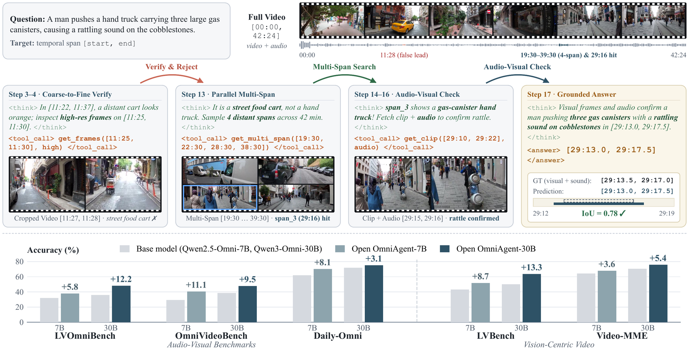
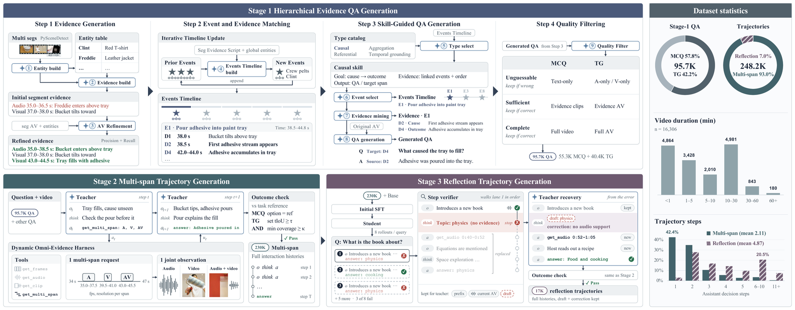
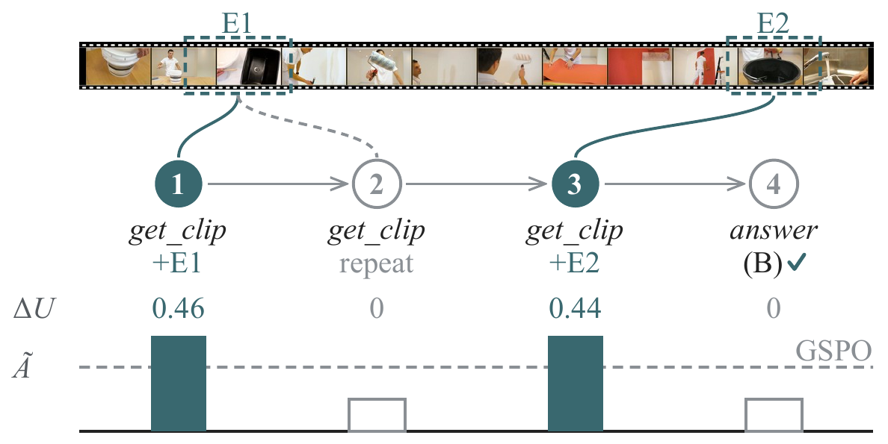

<div align="center">


# Open-OmniCoach

### Evidence-Enhanced Trajectory Learning for Omni Video Agents

<p>
  <a href="#news--release-roadmap"></a>
  <a href="https://open-omnicoach.github.io"></a>
  <a href="https://huggingface.co/collections/Open-OmniCoach/open-omnicoach-6b02b581ecac90284c6009d9"></a>
  <a href="https://huggingface.co/Open-OmniCoach/Open-OmniAgent-30B-A3B"></a>
  <a href="https://huggingface.co/datasets/Open-OmniCoach/OmniCoach-240K"></a>
  <a href="https://github.com/Open-OmniCoach/video-agent-evalkit/tree/omnicoach"></a>
  <a href="LICENSE"></a>
</p>

**English** | [简体中文](README_zh.md)

</div>

> **Open-OmniCoach** is a trajectory-learning framework for evidence-seeking omni-modal video agents. Given a long video and an audio-visual question, the agent actively inspects visual frames, audio segments, and synchronized audio-visual clips across multiple time spans—verifying hypotheses, correcting false leads, and grounding its final answer in retrieved evidence.

<p align="center">
  
</p>

## Highlights

- **Active multi-span omni-perception**: Equips Qwen-Omni models with four native tools (`get_frames`, `get_audio`, `get_clip`, `get_multi_span`) to query arbitrary time windows across visual, audio, and joint audio-visual modalities in parallel.
- **OmniCoach-240K trajectory dataset**: **248.2K** outcome-verified trajectories (**230.7K** multi-span + **17.4K** reflection recovery trajectories) built with fine-grained audio-visual evidence timelines and stepwise error-recovery supervision.
- **SEPO + Turn-Level GSPO**: Step-Level Evidence-Guided Policy Optimization (**SEPO**) scales per-turn RL advantages by incremental evidence coverage and localization gain ($\Delta U$), trained end-to-end on upgraded [`THUDM/slime`](https://github.com/THUDM/slime) with Turn-Level GSPO.
- **Consistent gains across 7B and 30B backbones**: **Open OmniAgent-30B** improves average accuracy over Qwen3-Omni-30B-A3B by **+6.3 pp** across 9 benchmarks, including **+12.2 pp** on LVOmniBench, **+13.3 pp** on LVBench, and **+10.3 pp** on Video-MME v2; **Open OmniAgent-7B** improves 5-benchmark omni-video average over Qwen2.5-Omni-7B by **+6.3 pp**.

## News & Release Roadmap

- **[2026-11]** Released the **Open-OmniCoach** codebase (`harness/`, `sft/`, `rl/`, `evalkit/`), interactive [project page](https://open-omnicoach.github.io), [**Open-OmniAgent-7B**](https://huggingface.co/Open-OmniCoach/Open-OmniAgent-7B) & [**Open-OmniAgent-30B-A3B**](https://huggingface.co/Open-OmniCoach/Open-OmniAgent-30B-A3B) checkpoints, and [**OmniCoach-240K**](https://huggingface.co/datasets/Open-OmniCoach/OmniCoach-240K) trajectory dataset.

**Released**
- [x] [Project page & interactive trajectory explorer](https://open-omnicoach.github.io)
- [x] Offline trace-collection harness ([`harness/`](harness/README.md))
- [x] Agent SFT & shared-media Parquet pipeline ([`sft/`](sft/README.md))
- [x] Qwen3-Omni RL engine, Turn-Level GSPO & GRPO/GSPO recipes ([`rl/`](rl/README.md))
- [x] Inference & benchmark evaluation via [Video Agent EvalKit](https://github.com/Open-OmniCoach/video-agent-evalkit/tree/omnicoach) (`evalkit/`)
- [x] [`Open-OmniAgent-7B`](https://huggingface.co/Open-OmniCoach/Open-OmniAgent-7B) & [`Open-OmniAgent-30B-A3B`](https://huggingface.co/Open-OmniCoach/Open-OmniAgent-30B-A3B) checkpoints on Hugging Face
- [x] [`OmniCoach-240K`](https://huggingface.co/datasets/Open-OmniCoach/OmniCoach-240K) trajectory dataset on Hugging Face

**Upcoming**
- [ ] Paper on arXiv
- [ ] Full SEPO step-level credit RL recipe

## Model and Dataset Zoo

| Artifact | Base Model / Composition | Scale | Status |
| --- | --- | --- | --- |
| [**Open-OmniAgent-7B**](https://huggingface.co/Open-OmniCoach/Open-OmniAgent-7B) | Qwen2.5-Omni-7B | 7B | Available |
| [**Open-OmniAgent-30B-A3B**](https://huggingface.co/Open-OmniCoach/Open-OmniAgent-30B-A3B) | Qwen3-Omni-30B-A3B-Instruct | 30B (3B active MoE) | Available |
| [**OmniCoach-240K**](https://huggingface.co/datasets/Open-OmniCoach/OmniCoach-240K) | 230.7K multi-span + 17.4K reflection trajectories | 248.2K trajectories | Available |

> All checkpoints and trajectory datasets are publicly available in the [**Open-OmniCoach Hugging Face Collection**](https://huggingface.co/collections/Open-OmniCoach/open-omnicoach-6b02b581ecac90284c6009d9).

## Performance at a Glance

Headline accuracy (%) on audio-visual (Omni-Video) and vision-centric long-video benchmarks:

| Model | Size | WorldSense | Daily-Omni | JointAV | OmniVideoBench | LVOmniBench | **Omni Avg.** | Video-MME | Video-MME v2 | LVBench |
| --- | :---: | :---: | :---: | :---: | :---: | :---: | :---: | :---: | :---: | :---: |
| Qwen2.5-Omni | 7B | 45.4 | 62.1 | 56.5 | 29.3 | 32.0 | 45.1 | 64.3 | -- | 43.0 |
| **Open OmniAgent-7B (Ours)** | **7B** | 48.9 | 70.2 | 59.3 | 40.4 | 37.8 | **51.3** *(+6.3)* | 67.9 | 36.5 | 51.7 |
| Qwen3-Omni-Instruct | 30B-A3B | 54.0 | 71.9 | 63.6 | 38.4 | 35.8 | 52.7 | 70.5 | 34.1 | 50.2 |
| **Open OmniAgent-30B (Ours)** | **30B-A3B** | **54.8** | **75.0** | **64.9** | **47.9** | **48.0** | **58.1** *(+5.4)* | **75.9** | **44.4** | **63.5** |

<details>
<summary><b>Full Omni-Video benchmark results (Table 1)</b></summary>

| Method | Size | WorldSense | Daily-Omni | JointAVBench | OmniVideoBench | LVOmniBench | **Avg.** |
| --- | :---: | :---: | :---: | :---: | :---: | :---: | :---: |
| *Proprietary Models* | | | | | | | |
| GPT-4o | -- | 42.6 | 56.5 | 45.0 | -- | -- | -- |
| Gemini-2.0-Flash | -- | -- | 67.8 | -- | 41.5 | 42.9 | -- |
| Gemini-2.5-Pro | -- | 65.1 | 80.6 | 65.3 | 58.9 | -- | -- |
| Gemini-3.0-Pro | -- | 66.4 | 81.1 | -- | 61.8 | 65.8 | -- |
| *Open-Source Generalist Models* | | | | | | | |
| video-SALMONN 2+ | 7B | 50.9 | 71.8 | 46.7 | 36.4 | 32.7 | 47.7 |
| OmniVinci | 9B | 48.2 | 66.5 | -- | 32.1 | -- | -- |
| Qwen2.5-VL | 7B | 35.5 | 40.7 | 47.7 | 29.8 | -- | -- |
| Qwen2.5-Omni | 7B | 45.4 | 62.1 | 56.5 | 29.3 | 32.0 | 45.1 |
| Qwen3-Omni-Instruct | 30B-A3B | 54.0 | 71.9 | 63.6 | 38.4 | 35.8 | 52.7 |
| *Open-Source Agentic Models* | | | | | | | |
| OmniAgent | 7B | 47.2 | 64.8 | -- | 37.1 | -- | -- |
| **Open OmniAgent-7B (Ours)** | 7B | 48.9 | 70.2 | 59.3 | 40.4 | 37.8 | 51.3 |
| *&Delta; vs. Qwen2.5-Omni* | | *+3.5* | *+8.1* | *+2.8* | *+11.1* | *+5.8* | *+6.3* |
| **Open OmniAgent-30B (Ours)** | 30B-A3B | **54.8** | **75.0** | **64.9** | **47.9** | **48.0** | **58.1** |
| *&Delta; vs. Qwen3-Omni* | | *+0.8* | *+3.2* | *+1.3* | *+9.5* | *+12.2* | *+5.4* |

</details>

<details>
<summary><b>Full Vision-Centric video benchmark results (Table 2)</b></summary>

| Method | Size | Video-MME | Video-MME v2 (Acc) | Video-MME v2 (Rating) | LongVideoBench | LVBench | VZB (L3) |
| --- | :---: | :---: | :---: | :---: | :---: | :---: | :---: |
| *Proprietary Models* | | | | | | | |
| GPT-4o | -- | 71.9 | -- | -- | 66.7 | 48.9 | -- |
| Gemini-1.5-Pro | -- | 75.0 | -- | -- | 64.0 | 33.1 | -- |
| Gemini-2.5-Pro | -- | -- | -- | -- | 76.8 | 67.4 | 16.4 |
| Gemini-3.0-Pro | -- | 88.6 | 66.1 | 49.4 | 75.9 | 77.0 | 17.0 |
| *Open-Source Generalist & Agentic Models* | | | | | | | |
| Qwen2.5-Omni | 7B | 64.3 | -- | -- | 53.8 | 43.0 | -- |
| Qwen3-Omni-Instruct | 30B-A3B | 70.5 | 34.1 | 17.1 | 66.9 | 50.2 | -- |
| Qwen3-VL-Instruct | 8B | 71.4 | 35.7 | 18.2 | 66.4 | 58.0 | 8.2 |
| Qwen3-VL-Instruct | 235B-A22B | 79.2 | 43.3 | 25.0 | -- | 67.7 | 9.6 |
| Qwen3.5 | 397B-A17B | **83.7** | 42.1 | 24.5 | -- | **75.5** | 10.6 |
| OmniAgent | 7B | 67.8 | -- | -- | -- | 50.5 | -- |
| **Open OmniAgent-7B (Ours)** | 7B | 67.9 | 36.5 | 18.4 | 57.1 | 51.7 | 6.4 |
| *&Delta; vs. Qwen2.5-Omni* | | *+3.6* | | | *+3.3* | *+8.7* | |
| **Open OmniAgent-30B (Ours)** | 30B-A3B | 75.9 | **44.4** | **25.5** | **67.4** | 63.5 | **12.0** |
| *&Delta; vs. Qwen3-Omni* | | *+5.4* | *+10.3* | *+8.4* | *+0.5* | *+13.3* | |

</details>

<details>
<summary><b>Ablation study on Qwen3-Omni-30B-A3B-Instruct (Table 3)</b></summary>

| Method / Setting | Stage | Video-MME | Video-MME v2 | OmniVideoBench | LVOmniBench | **Avg.** |
| --- | :---: | :---: | :---: | :---: | :---: | :---: |
| Qwen3-Omni-30B-A3B-Instruct | Base | 70.5 | 34.1 | 38.4 | 35.8 | 44.7 |
| + Multi-Span Trajectory (230.7K) | SFT | 72.9 | 40.7 | 44.7 | 46.8 | 51.3 |
| + Reflection Trajectory (+17.4K) | SFT | 74.4 | 42.6 | 46.3 | 47.5 | 52.7 |
| + GSPO (RL baseline) | RL | 75.4 | 43.3 | 46.9 | 47.7 | 53.3 |
| **+ SEPO (Ours, final)** | **RL** | **75.9** | **44.4** | **47.9** | **48.0** | **54.1** |

</details>

## How It Works

### 1. Active-Perception Toolset

Starting from a coarse overview of the video, the agent iteratively requests fine-grained evidence using four tools before emitting its final answer:

| Tool | Modality | Purpose |
| --- | :---: | --- |
| `get_frames` | Visual | Sample frames over a chosen time window at configurable FPS and resolution (`default` / `high`) |
| `get_audio` | Audio | Decode a raw audio waveform segment to verify speech, ambient sound, or acoustic cues |
| `get_clip` | Audio-Visual | Fetch synchronized video frames and audio over an interval for joint cross-modal verification |
| `get_multi_span` | Visual / Audio / AV | Batch multiple non-contiguous time spans in a single turn to search long videos efficiently |

### 2. Three-Stage Data & Trajectory Pipeline (OmniCoach-240K)

<p align="center">
  
</p>

1. **Hierarchical Evidence QA Generation**: Builds fine-grained audio-visual scripts linked to a global event timeline, generating skill-guided MCQ and Temporal Grounding (TG) tasks filtered for unguessability, sufficiency, and completeness (95.7K QA pairs, combined with 10K other-source public QA samples).
2. **Multi-Span Trajectory Generation**: Generates parallel multi-span, multimodal teacher trajectories in the Dynamic Omni-Evidence Harness and retains outcome-verified trajectories (230.7K multi-span trajectories).
3. **Reflection Trajectory Generation**: A stepwise verifier pinpoints mistakes in student rollouts; the teacher preserves the erroneous draft, injects an evidence-grounded correction and revised tool call, and continues to a verified answer (17.4K reflection trajectories).

### 3. Step-Level Evidence-Guided Policy Optimization (SEPO)

<p align="center">
  
</p>

Trajectory-level RL rewards assign the same advantage to every step in a rollout, blurring useful evidence retrieval and redundant calls. **SEPO** scores each tool turn by its incremental gain in annotated evidence coverage and temporal localization ($\Delta U$), combining outcome advantage with step-conditioned leave-one-out process credit and optimizing per-turn policy ratios via **Turn-Level GSPO** (`--use-turn-level-gspo`).

> **Note:** The generic Turn-Level GSPO engine (`--use-turn-level-gspo`) and outcome-based Agent-GSPO recipe are included in [`rl/`](rl/README.md). The full SEPO step-level credit recipe will be released alongside the paper.

## Repository Structure

Each module keeps an isolated environment so training dependencies never collide with lightweight inference or evaluation.

```text
omnicoach/
├── assets/             # Paper figures and logo used in documentation
├── docs/               # Protocol comparison & model serving guides
├── harness/            # Offline trace-collection actor runtime (omnicoach_harness, omni_ota_v1)
├── sft/                # Multi-turn Agent SFT (omnicoach_sft + shared-media Parquet)
├── rl/                 # Qwen3-Omni RL on THUDM/slime (GRPO, GSPO, Turn-Level GSPO)
└── evalkit/            # Video Agent EvalKit (VAE) submodule for inference & benchmark evaluation
```

| Stage | Directory | What lives here |
| --- | --- | --- |
| Model Inference & Evaluation | [`evalkit/`](https://github.com/Open-OmniCoach/video-agent-evalkit/tree/omnicoach) | [Video Agent EvalKit](https://github.com/Open-OmniCoach/video-agent-evalkit/tree/omnicoach) submodule (`omnicoach` branch) with Qwen2.5-Omni-7B & Qwen3-Omni-30B-A3B agent configs |
| Trace Collection | [`harness/`](harness/README.md) | `omnicoach_harness` frozen JSON Observe-Think-Action (`omni_ota_v1`) actor runtime for offline trace collection |
| Supervised Fine-Tuning | [`sft/`](sft/README.md) | `omnicoach_sft` shared-media Parquet builder, fast pack-length indexer, reflection loss masks, generic Swift/Megatron launcher |
| Reinforcement Learning | [`rl/`](rl/README.md) | Reusable `slime_ext` Qwen3-Omni + Agent + Turn-Level GSPO runtime, `THUDM/slime` patch, and 2 decoupled recipes (`qwen3_omni_rl`, `qwen3_omni_agent_gspo`) |

Additional guides:
- **[`docs/protocols.md`](docs/protocols.md)** — Wire-format comparison between `harness/` (offline JSON OTA + `MM:SS.m`) and `rl/slime_ext/agent/` (online `<tool_call>` + `"Ns"`).
- **[`docs/deployment.md`](docs/deployment.md)** — Serving Qwen2.5-Omni / Qwen3-Omni / Open-OmniAgent checkpoints with SGLang or vLLM.

## Quick Start

### 0. Clone with Submodules

```bash
git clone --recurse-submodules https://github.com/Open-OmniCoach/omnicoach.git
cd omnicoach
```

If you cloned without `--recurse-submodules`:

```bash
git submodule update --init --recursive
```

### 1. Serve & Evaluate Open-OmniAgent (`evalkit/`)

Start an OpenAI-compatible multimodal server (see [`docs/deployment.md`](docs/deployment.md)), then run single-video inference or benchmark suites from the `evalkit/` submodule (`omnicoach` branch; see [`evalkit` OmniCoach setup](https://github.com/Open-OmniCoach/video-agent-evalkit/blob/omnicoach/examples/omni_agent/README.md)):

```bash
cd evalkit
uv sync --locked
# Configure your endpoint & benchmark root, then run:
# examples/omni_agent/configs/qwen2_5_omni/run.yaml
# examples/omni_agent/configs/qwen3_omni/run.yaml
```

### 2. Offline Trace Collection (`harness/`)

See [`harness/README.md`](harness/README.md) to verify the frozen JSON Observe-Think-Action protocol (`omni_ota_v1`) or run offline trace collection:

```bash
cd harness
uv sync --locked
uv run omnicoach-harness doctor
uv run omnicoach-harness describe --entrypoint omnicoach_harness.protocol.route:build
```

### 3. Supervised Fine-Tuning (`sft/`)

See [`sft/README.md`](sft/README.md) for environment setup, dataset export, and launching with `scripts/train.sh`:

```bash
cd sft
# Preview the reported Qwen3-Omni agent-SFT recipe without launching GPUs:
DRY_RUN=1 bash scripts/train.sh config/train/qwen3_omni_agent_sft.yaml
```

### 4. Reinforcement Learning (`rl/`)

`rl/` builds on pinned `THUDM/slime` (`79aa41a8`) via [`tools/env/patches/slime-omni.patch`](rl/tools/env/patches/slime-omni.patch), provides generic Turn-Level GSPO (`--use-turn-level-gspo`), and ships two decoupled recipes (`examples/qwen3_omni_rl`, `examples/qwen3_omni_agent_gspo`). See [`rl/README.md`](rl/README.md) for full GPU setup:

```bash
cd rl
source tools/env/versions.env
git clone https://github.com/THUDM/slime.git third_party/slime
git -C third_party/slime checkout "${SLIME_COMMIT}"
bash tools/env/prepare_slime.sh apply && bash tools/env/prepare_slime.sh check

# CPU test suite & dry-run check:
CUDA_VISIBLE_DEVICES="" PYTHONDONTWRITEBYTECODE=1 PYTHONPATH=".:third_party/slime" \
  pytest -v tests/core tests/agent tests/examples
DRY_RUN=1 bash examples/qwen3_omni_agent_gspo/run.sh
```

## Citation

If you find **Open-OmniCoach** helpful for your research, please consider citing:

```bibtex
@misc{liu2026openomnicoach,
  title   = {Open-OmniCoach: Evidence-Enhanced Trajectory Learning for Omni Video Agents},
  author  = {Weisong Liu and Xiangtai Li and Haochen Wang and Haiquan Wen and Zhaoxiang Zhang},
  year    = {2026},
  note    = {arXiv preprint, coming soon}
}
```

## Acknowledgements

Open-OmniCoach builds on the open-source ecosystem including [`THUDM/slime`](https://github.com/THUDM/slime), [`Qwen-Omni`](https://github.com/QwenLM/Qwen3-Omni), [`ms-swift`](https://github.com/modelscope/ms-swift), [`SGLang`](https://github.com/sgl-project/sglang), [`Megatron-Core`](https://github.com/NVIDIA/Megatron-LM), and [`Video Agent EvalKit`](https://github.com/Open-OmniCoach/video-agent-evalkit).

## License

Released under the [Apache License 2.0](LICENSE). Third-party components and submodules retain their respective licenses.
