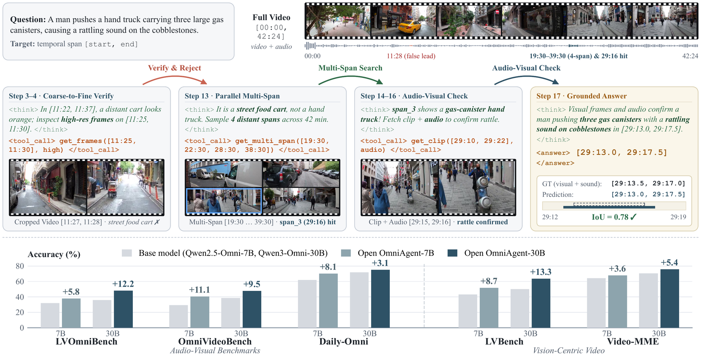
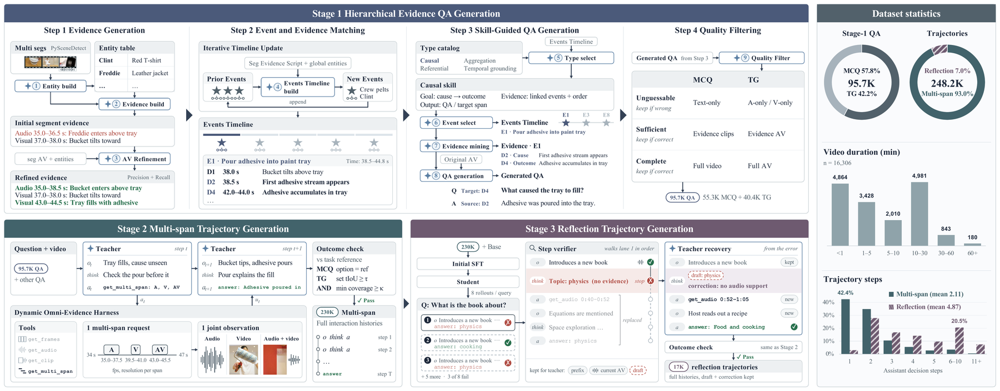
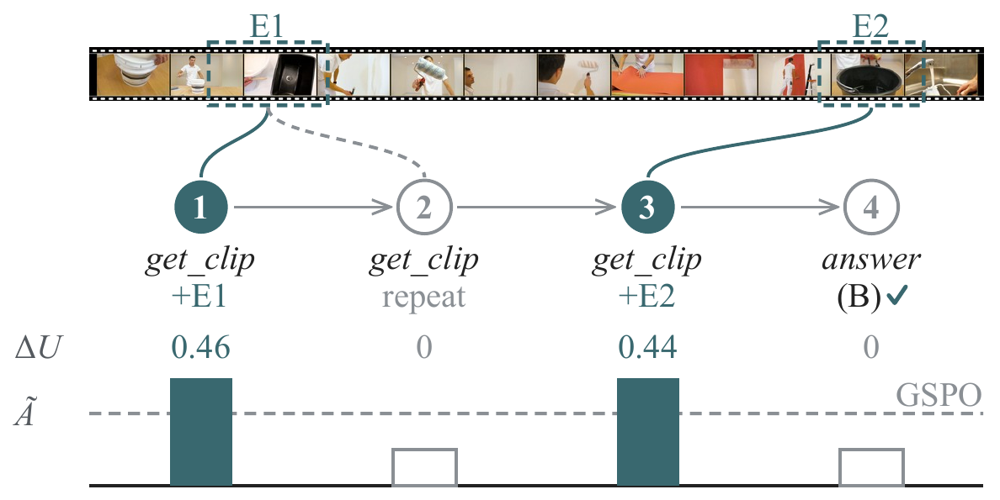

<div align="center">


# Open-OmniCoach

### 面向全模态视频智能体的证据增强轨迹学习框架

**项目负责人：** Xiangtai Li

<p>
  <a href="https://github.com/Open-OmniCoach/omnicoach/stargazers"></a>
  <a href="https://arxiv.org/abs/2611.31891"></a>
  <a href="https://open-omnicoach.github.io"></a>
  <a href="https://huggingface.co/collections/Open-OmniCoach/open-omnicoach-6b02b581ecac90284c6009d9"></a>
  <a href="https://huggingface.co/Open-OmniCoach/Open-OmniAgent-30B-A3B"></a>
  <a href="https://huggingface.co/datasets/Open-OmniCoach/OmniCoach-240K"></a>
  <a href="https://github.com/Open-OmniCoach/video-agent-evalkit/tree/omnicoach"></a>
  <a href="LICENSE"></a>
</p>

[English](README.md) | **简体中文**

</div>

> **Open-OmniCoach** 是一个面向主动取证型全模态视频智能体（Omni Video Agents）的轨迹学习框架。面对长视频与音视频问答/时序定位任务，智能体会主动在多个时间区间并行调用视觉帧、音频段与同步音视频片段工具，验证假设、纠正误判，并基于检索到的真实证据给出最终回答。

<p align="center">
  
</p>

## 核心亮点

- **多片段全模态主动感知**：为 Qwen-Omni 系列配备 4 个原生工具（`get_frames`、`get_audio`、`get_clip`、`get_multi_span`），支持单轮并行查询多个非连续时间区间的视觉、音频或同步音视频证据。
- **OmniCoach-240K 高质量轨迹数据**：共 **248.2K** 条结果校验轨迹（**230.7K** 多片段轨迹 + **17.4K** 反思纠错轨迹），结合细粒度音视频证据时间线与步级纠错恢复监督构建。
- **SEPO + Turn-Level GSPO**：提出步级证据引导策略优化（**SEPO**），按每轮工具调用带来的证据覆盖与时序定位增量（$\Delta U$）分配步骤级优势，并在升级版 [`THUDM/slime`](https://github.com/THUDM/slime) 上通过 Turn-Level GSPO 实现端到端强化学习。
- **7B 与 30B 基座一致大幅提升**：**Open OmniAgent-30B** 在 9 个基准上较 Qwen3-Omni-30B-A3B 平均提升 **+6.3 pp**（其中 LVOmniBench **+12.2 pp**、LVBench **+13.3 pp**、Video-MME v2 **+10.3 pp**）；**Open OmniAgent-7B** 在 5 个全模态视频基准上较 Qwen2.5-Omni-7B 平均提升 **+6.3 pp**。

## 发布动态与路线图

- **[2026-11-25]** 已发布 [arXiv 论文](https://arxiv.org/abs/2611.31891)。
- **[2026-11]** 正式发布 **Open-OmniCoach** 开源代码（`harness/`、`sft/`、`rl/`、`evalkit/`）、[项目主页](https://open-omnicoach.github.io)、[**Open-OmniAgent-7B**](https://huggingface.co/Open-OmniCoach/Open-OmniAgent-7B) 与 [**Open-OmniAgent-30B-A3B**](https://huggingface.co/Open-OmniCoach/Open-OmniAgent-30B-A3B) 模型权重，以及 [**OmniCoach-240K**](https://huggingface.co/datasets/Open-OmniCoach/OmniCoach-240K) 轨迹数据集。

**已发布**
- [x] [arXiv 论文](https://arxiv.org/abs/2611.31891)
- [x] [项目主页与交互式轨迹浏览器](https://open-omnicoach.github.io)
- [x] 离线轨迹采集框架（[`harness/`](harness/README.md)）
- [x] Agent SFT 训练与共享媒体 Parquet 管线（[`sft/`](sft/README.md)）
- [x] Qwen3-Omni RL 引擎、Turn-Level GSPO 与 GRPO/GSPO 配方（[`rl/`](rl/README.md)）
- [x] 推理与基准评测集成 [Video Agent EvalKit](https://github.com/Open-OmniCoach/video-agent-evalkit/tree/omnicoach)（`evalkit/`）
- [x] Hugging Face 模型权重（[`Open-OmniAgent-7B`](https://huggingface.co/Open-OmniCoach/Open-OmniAgent-7B) & [`Open-OmniAgent-30B-A3B`](https://huggingface.co/Open-OmniCoach/Open-OmniAgent-30B-A3B)）
- [x] Hugging Face 轨迹数据集（[`OmniCoach-240K`](https://huggingface.co/datasets/Open-OmniCoach/OmniCoach-240K)）

**即将发布**
- [ ] [OmniCoach-240K](https://huggingface.co/datasets/Open-OmniCoach/OmniCoach-240K) 的 17.4K 反思纠错轨迹
- [ ] 完整 SEPO 步级信用 RL 配方

> ⭐ 欢迎点击 **Star / Watch** 关注仓库，17.4K 反思轨迹与完整 SEPO 配方发布后将第一时间更新！

## 模型与数据集

| 产出 | 基座模型 / 构成 | 规模 | 发布状态 |
| --- | --- | --- | --- |
| [**Open-OmniAgent-7B**](https://huggingface.co/Open-OmniCoach/Open-OmniAgent-7B) | Qwen2.5-Omni-7B | 7B | 已发布 |
| [**Open-OmniAgent-30B-A3B**](https://huggingface.co/Open-OmniCoach/Open-OmniAgent-30B-A3B) | Qwen3-Omni-30B-A3B-Instruct | 30B（3B 激活 MoE） | 已发布 |
| [**OmniCoach-240K**](https://huggingface.co/datasets/Open-OmniCoach/OmniCoach-240K) | 230.7K 多片段轨迹 + 17.4K 反思纠错轨迹 | 248.2K 轨迹 | 种子 SFT 与 RL 数据已发布 |

[**OmniCoach-240K 下载与使用指南**](docs/omnicoach-240k.md)提供轨迹预览、预构建 SFT 与 RL Parquet 下载，以及训练数据准备说明。

## 核心性能一览

在全模态视频（Omni-Video）与通用长视频基准上的准确率（%）：

| 模型 | 参数量 | WorldSense | Daily-Omni | JointAV | OmniVideoBench | LVOmniBench | **Omni 均分** | Video-MME | Video-MME v2 | LVBench |
| --- | :---: | :---: | :---: | :---: | :---: | :---: | :---: | :---: | :---: | :---: |
| Qwen2.5-Omni | 7B | 45.4 | 62.1 | 56.5 | 29.3 | 32.0 | 45.1 | 64.3 | -- | 43.0 |
| **Open OmniAgent-7B (Ours)** | **7B** | 48.9 | 70.2 | 59.3 | 40.4 | 37.8 | **51.3** *(+6.3)* | 67.9 | 36.5 | 51.7 |
| Qwen3-Omni-Instruct | 30B-A3B | 54.0 | 71.9 | 63.6 | 38.4 | 35.8 | 52.7 | 70.5 | 34.1 | 50.2 |
| **Open OmniAgent-30B (Ours)** | **30B-A3B** | **54.8** | **75.0** | **64.9** | **47.9** | **48.0** | **58.1** *(+5.4)* | **75.9** | **44.4** | **63.5** |

完整主结果表与消融实验（Base → Multi-Span → Reflection → GSPO → SEPO）请查看英文主页 [Performance at a Glance](README.md#performance-at-a-glance)。

## 方法总览

### 1. 主动感知工具集

| 工具 | 模态 | 作用 |
| --- | :---: | --- |
| `get_frames` | 视觉 | 按指定时间窗口、采样帧率与分辨率（`default` / `high`）抽取视频帧 |
| `get_audio` | 音频 | 解码指定时间段的原始音频波形，用于验证语音、环境音与声学线索 |
| `get_clip` | 音视频 | 同步获取同一时间窗口的视频帧与音频，用于跨模态联合核验 |
| `get_multi_span` | 视觉 / 音频 / 音视频 | 单轮并行检索多个非连续时间区间，大幅提升长视频搜证效率 |

### 2. 三阶段数据与轨迹构造（OmniCoach-240K）

<p align="center">
  
</p>

1. **分层证据 QA 构造**：将细粒度音视频描述与全局事件时间线对齐，生成 MCQ 与时序定位（TG）任务，并经过不可盲猜性、充分性与完备性过滤（95.7K 条 QA，结合 10K 条外部公开 QA）。
2. **多片段轨迹构造**：教师模型在 Dynamic Omni-Evidence Harness 中并行多区间取证，仅保留通过结果校验的轨迹（230.7K 条）。
3. **反思纠错轨迹构造**：步级验证器定位学生 rollout 中的出错步骤，教师保留错误草稿并插入基于证据的纠偏推理与新工具调用，续写至正确结果（17.4K 条）。

### 3. 步级证据引导策略优化（SEPO）

<p align="center">
  
</p>

轨迹级统一优势无法区分一次 rollout 中“拿到关键证据的步骤”和“冗余调用”。**SEPO** 基于每步新覆盖的标注证据增益 $\Delta U$ 计算步级过程信用，并通过 **Turn-Level GSPO**（`--use-turn-level-gspo`）按轮次计算几何平均重要性比率进行策略更新。

> **说明：** 当前仓库已在 [`rl/`](rl/README.md) 开放通用的 Turn-Level GSPO 引擎（`--use-turn-level-gspo`）与纯结果奖励的 Agent-GSPO 配方；完整的 SEPO 步级信用配方计划后续发布。

## 仓库目录与快速开始

```text
omnicoach/
├── assets/             # 论文配图与 Logo
├── docs/               # 协议说明与模型部署指南
├── harness/            # 离线轨迹采集运行时（omnicoach_harness，协议 omni_ota_v1）
├── sft/                # 多轮 Agent SFT（omnicoach_sft + shared-media Parquet）
├── rl/                 # 基于 THUDM/slime 的 Qwen3-Omni RL（GRPO / GSPO / Turn-Level GSPO）
└── evalkit/            # 推理与评测子模块（Video Agent EvalKit，omnicoach 分支）
```

### 克隆仓库（含评测子模块）

```bash
git clone --recurse-submodules https://github.com/Open-OmniCoach/omnicoach.git
cd omnicoach
```

### 模型部署、推理与基准评测

请按 [`docs/deployment.md`](docs/deployment.md) 启动 OpenAI 兼容模型服务（SGLang / vLLM），随后通过 `evalkit/`（`omnicoach` 分支）运行推理与基准评测：见 [`evalkit` 集成指南](https://github.com/Open-OmniCoach/video-agent-evalkit/blob/omnicoach/examples/omni_agent/README.md)。

### SFT / RL / Harness 训练与采集入口

- **轨迹采集（Harness）**：见 [`harness/README.md`](harness/README.md)（`uv run omnicoach-harness describe --entrypoint omnicoach_harness.protocol.route:build`）
- **监督微调（SFT）**：见 [`sft/README.md`](sft/README.md)（支持 `DRY_RUN=1 bash scripts/train.sh config/train/qwen3_omni_agent_sft.yaml` 预览配置）
- **强化学习（RL）**：见 [`rl/README.md`](rl/README.md)（按说明拉取并 patch `third_party/slime` 后即可运行全量 CPU 单测与 `DRY_RUN=1 bash examples/qwen3_omni_agent_gspo/run.sh`）
- **两套工具协议对照**：见 [`docs/protocols.md`](docs/protocols.md)

## 引用

如果 **Open-OmniCoach** 对您的研究有所帮助，欢迎给本仓库点个 ⭐ 并引用我们的工作：

```bibtex
@misc{liu2026openomnicoach,
  title         = {Open-OmniCoach: Evidence-Enhanced Trajectory Learning for Omni Video Agents},
  author        = {Weisong Liu and Xiangtai Li and Haochen Wang and Haiquan Wen and Zhaoxiang Zhang},
  year          = {2026},
  eprint        = {2611.31891},
  archivePrefix = {arXiv},
  primaryClass  = {cs.CV},
  url           = {https://arxiv.org/abs/2611.31891}
}
```

## 开源协议

本项目基于 [Apache License 2.0](LICENSE) 发布，第三方依赖与子模块沿用其各自许可协议。
